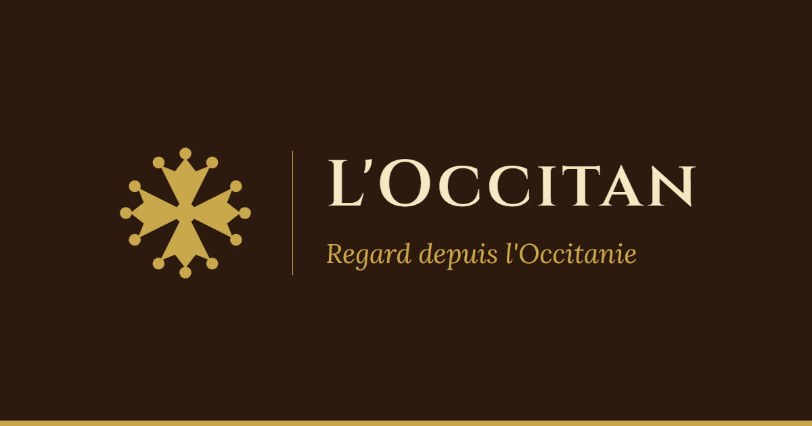

  

# L'Occitan — Regard depuis l'Occitanie

Depuis Lavaur, je regarde le monde : son histoire, ses spiritualités, ses idées, ses machines,
sa terre et sa musique. L'Occitan est un journal de réflexion, pas de commentaire à chaud.

**Site :** [gaby-ridaya.github.io/Climat](https://gaby-ridaya.github.io/Climat/)

## Les rubriques

- **Histoire & Musique** — les troubadours, l'histoire de Lavaur
- **Pensée & Spiritualité** — philosophie, spiritualité, astrologie
- **IA & Technologie**
- **Environnement** — études chiffrées à partir de données publiques

Les sources sont citées sur chaque page. Les images sont des illustrations.

## Contact

Gabriel Alba — [gabriel.ridaya@protonmail.com](mailto:gabriel.ridaya@protonmail.com)

Contenu sous licence [MIT](LICENSE).
